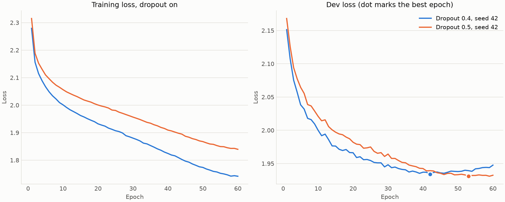
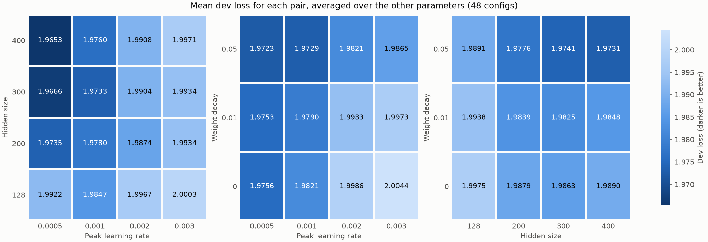
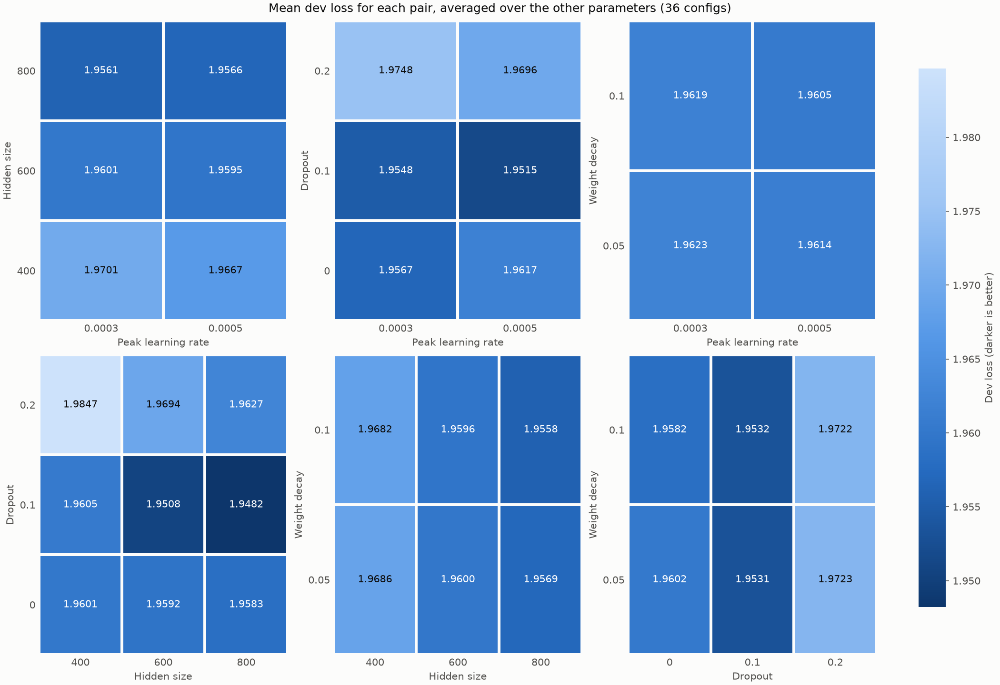
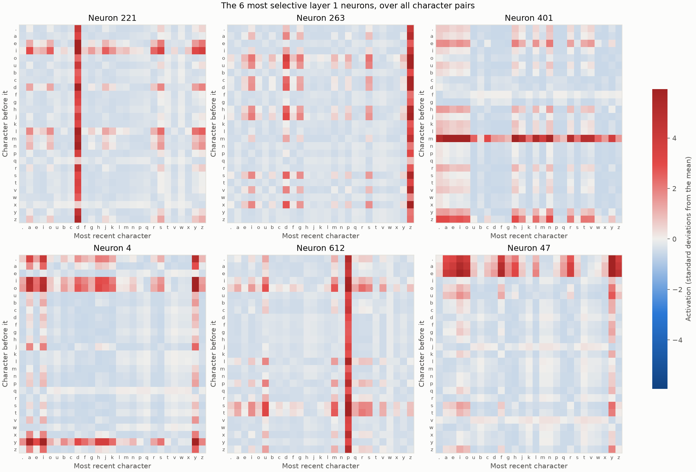
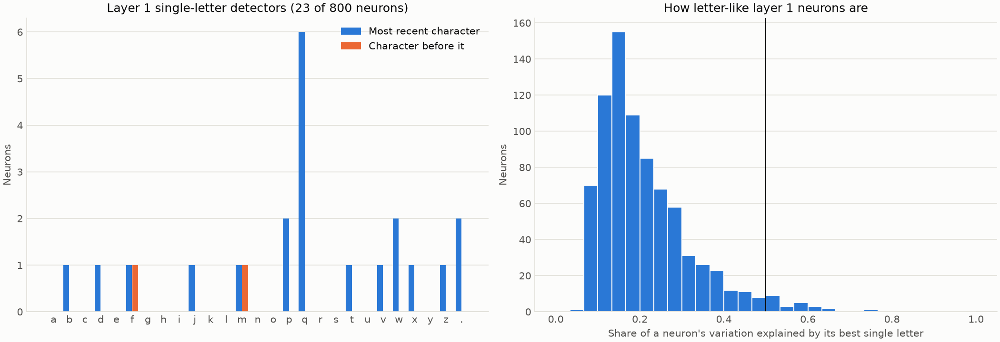
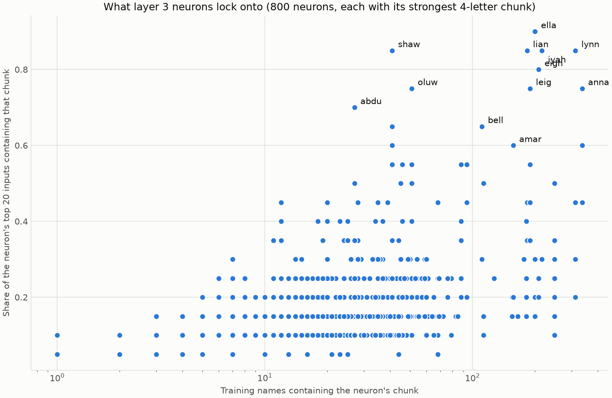

# makemore: tuning a character-level name generator

## Summary

This is my silly little overkill makemore tuning repo, inspired by the [videos](https://www.youtube.com/playlist?list=PLAqhIrjkxbuWI23v9cThsA9GvCAUhRvKZ) and [notebook](https://github.com/karpathy/nn-zero-to-hero/blob/master/lectures/makemore/makemore_part5_cnn1.ipynb) by Andrej Karpathy. Note that the [main makemore repo](https://github.com/karpathy/makemore) repo has a lot of changes from the video. I have not explored that repo, this is a stop on my ML learning journey.

My goal with this was to reimplement, from a blank file, using normal pytorch to replace the handcoded pieces in the original video, and then tune it as best I could without significantly changing the topology of the network; I generally stuck to swapping algorithms and tuning hyperparameters.

The results were solid, beating the loss in the original video comfortably, and likely approaching the best you can reasonably do at this problem (and with this dataset). As pointed out in the video, losses near zero are never possible, since multiple characters can come next in most scenarios. A perfectly functioning model capable of consistently producing novel pronouncable names will still have a loss near 2.

I'm likely making multiple mistakes or poor design choices in this repo. The primary purpose of this is for me to get comfortable building and training a neural network. Please do feel free to point out issues, as that helps me learn. Also feel free to point out good choices, as that feeds my ego.

#### Final validation loss: **1.9391**
Best dev loss: **1.9314**

This started from dev losses above 2 that were already showing signs of overfitting the training set (gap between training and dev loss was .2 and growing). I used the same cross entropy loss from the original video. Some thoughts on that later.

The main takeaways from this experiment is:
- You have to fight for every loss improvement when you only have a corpus of 32k words to train on.
- Tuning hyperparameters is kinda fun.
- Sometimes loss can't approach 0. It's worth thinking about why.
- Just start with a plan, then make predictions, gather data, and make changes based on that. You aren't going to just predict the best model shape at the start.

One more thing worth noting that actually matters quite a bit: `names.txt` contains duplicate names. That means that validation against dev and validation sets contained some names that the model had seen in training. I chose not to correct this in the advertised result, because the original "try to beat this loss" number of 1.99 also did not handle this. For completeness, removing previously seen names from the validation set (about 12% of the validation data) so that it can't benefit from overfitting raised the validation loss to **1.9663**. I imagine Andrej's result would've been comfortably over 2.0 if he had done the same, but that is speculating, of course.

## Background
This is artifact #2 from my journey from software engineer to AI researcher. I took the generally accepted wisdom to heart, and started working through Andrej Karpathy's [Neural Networks: Zero to Hero]([videos](https://www.youtube.com/playlist?list=PLAqhIrjkxbuWI23v9cThsA9GvCAUhRvKZ)) video series on youtube. It has not disappointed; it's a perfect transition from SWE to ML, reviewing the math I'm rusty on and making sure I understand what's under the hood before letting me take some building block for granted. 

After re-implementing micrograd (see the other folder in this repo), I started watching the makemore videos, playing with examples in a notebook as I went, but realized the interesting artifact was going to be the tuning at the end.

For context for anyone who doesn't know about makemore: It's a small neural network designed to predict the next character in a sequence. Specifically, the intent is to train it on a corpus of single words that share some style, and then it can be used to produce more words in a similar style. The canonical case is names. `names.txt`, taken from the original project, contains 32,000 names. This trains the model to produce (mostly) novel name-like strings of characters.

Something to keep in mind about the loss function used here (the same one used in the original project) is that it puts a high floor underneath our loss. It uses cross entropy, which is common and makes some good sense, but it's important to note that, because there is no single "correct" next letter in a sequence, and in fact our training set has many instances of sequences having many possible next characters. For example, the characters 'an' can be followed by many different combinations:

```
annison
anoush
anousheh
anran
anri
ansha
anta
```

And this is just a small subset of the names that start with 'an' in `names.txt`. That means that no matter what the network's predicted probabilities are, it's going to have substantial loss. In fact, given our 8 character window, and the fact that we're extracting every completion case from each name, we can calculate the loss floor for this particular dataset to be **1.4108**, which would be the model completely memorizing the dataset/complete overfitting. I don't have math to justify it, but I feel pretty certain that, without a much large and more complex model, our loss is very near the practical limit.

One more nerdy note that I had Claude help me deduce: Interestingly, a block size/context window of 8 is actually a perfect choice for this dataset. Increasing the window size doesn't really increase the loss floor, especially since most names aren't longer than 8 characters, but smaller does quickly increase it. Also, it allows us to use the simple manual form of dilation the model implements. 

## A Note on Agent Usage

I used Claude in this repo once I had broken the notebook out into a more easily testable/tunable set of functions. Claude wrote substantial boilerplate for me, and acted as an advisor, but made no design choices independently. The point of this was for me to learn this stuff, even if I'm likely to lean on Claude the future; vibe coding this would teach me nothing.

## Data
`names.txt` comes straight from the makemore repo (MIT licensed, see `names.txt.LICENSE`). It has 32,033 names and only 27 characters: a to z, plus `.` to mark the start and end of a name.

Every character in a name becomes one training example: the previous 8 characters go in, and the next character is the target. Names are split randomly, 80/10/10.

| Split | Names | Examples |
|---|---|---|
| train | 25,626 | 182,819 |
| dev | 3,203 | 22,760 |
| val | 3,204 | 22,567 |

Naming is a little confusing here. In this repo, `dev` is what I tuned against, and `val` is the held-out test set. If you're used to train/val/test, my `val` is your `test`.

I only ran val on the final model, and then a second time to work out the duplicate-free number from the summary. Nothing got chosen based on it.

## Model
This is the same tree shape as the last makemore video. It combines characters in pairs, then pairs of pairs, then pairs of those:

```
8 chars -> 4 groups of 2 -> 2 groups of 4 -> 1 group of 8 -> next character
```

Each level is Linear, LayerNorm, activation, dropout. Karpathy points out in the video that this is really a convolution done by hand, and that's also why block size is stuck at 8: we halve three times, so 8 is the only size that comes out even. Any other size would mean changing the architecture.

The winning model has 2,625,475 parameters, nearly all of them in the two 1600 -> 800 layers (1.28M each). The embeddings are only 648 of them, so embedding size barely affects model size. Hidden size is what costs you.

## Moving from notebook to scripts
My notebook finished with train 1.8203 and dev 1.9944. That was hidden 200, embedding 24, batch 64, 15 epochs, AdamW at lr 3e-3, no dropout, no weight decay, and MultiStep dropping the learning rate at 50% and 75% of training.

So it already matched the video, and the gap of 0.17 told me where the problem was. I also noticed the loss sat flat for the first half of training and only moved once the first LR drop hit, so the starting LR was too high. Weight decay of 0.1 on everything made things worse.

To tune any of this I needed something better than rerunning notebook cells, so I pulled the pieces out into `makemore_improve.py`: data loading, model, optimizer, training, evaluation, and name generation. Claude did a typing pass because I'm a good litle SWE, and that surfaced a few real bugs I then fixed.

## Experiment setup
This is where I started leveraging claude more, as I had designed the experiment already, and wiring it up is boilerplate. I had it build `makemore_experiment.py` to my specification. Each experiment is a named round with its own grid and results file:

```bash
python makemore_experiment.py --round round4 --workers 4 --save-weights
python makemore_experiment.py --round round4 --top 5 --seeds 43 44 45
```

These stayed fixed the whole way through: batch 64, embedding 24, AdamW, and warmup for 500 steps followed by cosine decay to 0.1x peak LR.

Weight decay only applies to Linear weights. LayerNorm, biases and embeddings are left out using parameter groups.

Runs happen in parallel processes with one torch thread each. That's faster than it sounds like it should be: one epoch took 3.8s with 1 thread and 6.8s with 8, because the threads just fight each other on a model this small.

Finished runs get appended to the results file and skipped on the next launch, so I could kill a sweep and pick it back up. `makemore_plots.py` turns a results file into line plots, heatmaps and 3D surfaces.

## Mistakes
- **Seeds changed the dev set.** One seed controlled both the split and the shuffle, so a new seed meant a new dev set. In a 1-epoch test, one config moved by 0.014 across seeds, which would've buried the differences I was trying to measure. With the split fixed, that dropped to 0.005, and full-length runs vary by about 0.002.
- **Reruns skewed the averages.** Configs rerun with `--top` got counted once per seed, which changed the per-value averages without any new information.
- **Claude chose to show Val at first.** It wasn't used for anything, but it was sitting in the results file where I'd see it, so I took it out for good practice.
- **Duplicate names.** I didn't check for them before splitting. Dedupe first.
- **Time estimates were bad.** Time grows roughly with the square of hidden size, so an 800 run costs about four times a 400 run.

## Results by round
All of these use dev loss, seed 42 unless noted.

### Round 1: lr x hidden x weight decay (Tanh)
48 configs, then extra seeds on the top few. The best was 1.9634 (lr 5e-4, hidden 400, wd 0.05) across 4 seeds, with a standard deviation of 0.0022.

The gap was about 0.25, and the best values were sitting at the edges of the grid: lowest LR, largest hidden size, most weight decay.

### Round 2: hidden x dropout x weight decay (Tanh)
36 configs and my first dropout. The best was 1.9473 (lr 5e-4, hidden 800, dropout 0.1, wd 0.1).

Dropout 0.1 helped, and 0.2 was too much for 15 epochs. Weight decay 0.05 and 0.1 were tied (1.9619 vs. 1.9612 on average), so I stopped sweeping it.

### Round 2-1: the GELU hunch
This was one run while round 2 was still going. I had a feeling a big network with dropout would do better with GELU, and I was right:

| Same config, same seed | Dev | Train | Gap |
|---|---|---|---|
| Tanh | 1.9643 | 1.8386 | 0.126 |
| GELU | 1.9412 | 1.6916 | 0.250 |

That was the biggest improvement from any single change. It also doubled the gap, so GELU needed more regularization than Tanh did.

### Round 3: lr x dropout (GELU)
9 configs. The best was 1.9379 (lr 5e-4, dropout 0.3). At dropout 0.3 and 0.4, a higher LR always won, which looked like those runs were running out of training time.

### Round 4: more epochs (GELU)
4 configs at 30 epochs. The best was 1.9314 (lr 5e-4, dropout 0.4).

| lr 5e-4 | 15 epochs | 30 epochs |
|---|---|---|
| Dropout 0.3 | 1.9379 | 1.9474 |
| Dropout 0.4 | 1.9489 | 1.9314 |

Doubling training made dropout 0.4 better and dropout 0.3 worse, because the extra epochs just gave 0.3 more time to overfit.

### Round 5: more dropout (GELU)
2 configs at 30 epochs. Dropout 0.5 got 1.9439 and 0.6 got 1.9719, both worse than 0.4. Both were still improving on the last epoch with smaller gaps, so they looked short of training rather than overfit.

### Round 6: 60 epochs (GELU)
2 configs at 60 epochs. Dropout 0.5 got 1.9324, which ties the round 4 winner within seed noise at twice the training time. Dropout 0.4 overfit: dev bottomed out at 1.9339 around epoch 42, then climbed to 1.9476 as the gap grew to 0.355.



Every dropout and epoch pairing that balances out lands around 1.93 with a gap of about 0.245. More dropout just takes longer to get there.

### Final evaluation
The winner is GELU, hidden 800, lr 5e-4, dropout 0.4, wd 0.1, 30 epochs, seed 42. I reloaded the saved weights, confirmed they reproduced the dev loss, and then ran val.

Train 1.6859, dev 1.9314, val 1.9391. Val landing a bit above dev is expected, since I picked this model using dev.

## Progress overview
| Step | Best dev loss |
|---|---|
| Notebook | 1.9944 |
| Round 1, tuned Tanh | 1.9634 |
| Round 2, dropout | 1.9473 |
| Round 2-1, GELU | 1.9412 |
| Round 3, more dropout | 1.9379 |
| Round 4, 30 epochs | 1.9314 |

Round 1, dev loss by pair of hyperparameters (darker is better):



Round 2:



## What I learned
- More training needs more regularization. Dropout and epochs aren't independent knobs.
- Changing the activation changes everything else. The dropout that was too high for Tanh wasn't high enough for GELU.
- The train/dev gap is the most useful number here. It told me what to try next almost every time.
- Keep the data fixed when you compare runs, or you end up measuring the data.
- The grid search didn't find the biggest improvement. A hunch did, and it took 20 minutes to check.
- The gains got small fast: 0.031, then 0.016, then under 0.007 each.

## Limits of these results
- The winner has only been run on one seed, so small differences near the top could be noise. Seed noise is about 0.002.
- Dropout 0.5 at 60 epochs tied the winner on one seed, so I can't say which of the two is really better.
- About 12% of dev and val examples come from names that are also in train. That's why the honest number on unseen names is 1.9663.
- The overlap may also flatter models that memorize more, though the winner is the high-dropout one.
- I never tested embedding size, ReLU, batch size, or anything deeper.

## Looking inside the model
`makemore_interpret.py` has a few basic interpretability tools. I hadn't done any of this before, and a model this small is a good place to start.

```bash
python makemore_interpret.py all
```

Softening the predictions with a temperature of 1.15 drops dev loss from 1.9314 to 1.9220 with no retraining, so the model is overconfident. I didn't count this in the results since I found it on dev, and val has been used already.

The last two characters matter about equally, and importance falls off fast after that.

Each heatmap below is one layer 1 neuron, tested on all 729 possible character pairs. Columns are the most recent character, and rows are the one before it. A red column means the neuron fires on that letter no matter what came before it, so neuron 221 is basically a `d` detector.



Those are the 6 cleanest neurons out of 800, so they flatter the layer. Only 23 neurons get at least half of their behavior from one letter. Six of those are on `q`, and none are on a vowel, which seem to get handled in groups instead.



Layer 3 sees all 8 characters, so that's where I'd expect memorizing to show up. For each neuron, I took the 20 windows that made it fire hardest and found the 4-letter chunk most of them share.



A neuron memorizing a name would sit in the top left, locked onto a chunk that hardly any names contain. That corner is empty. The strongest neurons land on pieces like `ella`, `lynn` and `anna`, which are in hundreds of names. The closest thing to memorizing is `abdu`, `shaw` and `luwa`, which are small families of about 30 to 50 names.

There are plenty of caveats here. I picked 4 letters by feel. A shared chunk doesn't prove that's what a neuron is really detecting. Most of the layer doesn't lock onto anything. This also only looks at single neurons, so memorizing could still be spread across many of them, which is what dropout would encourage. It's clearly happening somewhere, since val names that are also in train score 1.74, and new ones score 1.97.

Dropout 0.4 made the network very redundant. Silencing the single widest-ranging neuron in layer 3 changed dev loss by 0.0002, and removing half of layer 1 only cost about 0.02.

## The Bitter Lesson
I think I've hit the ceiling for this dataset. Every remaining signal says overfitting instead of a lack of capacity: the gap is still 0.25, and the winner needed 40% dropout just to keep that gap there.

So tuning can't get much further. The next real gain probably comes from about 10x more data, with a bigger network and a lot of dropout. That's a nice small-scale version of [The Bitter Lesson](http://www.incompleteideas.net/IncIdeas/BitterLesson.html): I can keep being clever, or I can get more data and compute.

More data would need a few architecture changes, like more layers and a way out of the fixed block size. The usual way out is proper dilated convolutions.

## Possible next steps
- Go further with the interpretability tools, like comparing a low-dropout model
- Try about 10x more data
- Measure what I actually care about, which is novel, pronounceable names

That last one is the one I keep thinking about. Cross entropy measures how well the model predicts the corpus, not whether the names are any good. Held-out loss is a decent stand-in, since it rewards plausible names the model hasn't seen, but it isn't the goal. Unfortunately, I don't know of a good way to evaluate the quality of an output without either training another model to attempt to pronounce them (obviously a huge undertaking that also obviates this model entirely) or simply having humans label them, which is out of scope here. So I think cross-entropy is the best we have.

Novelty is simple to measure: at temperature 1, 57 of my 100 names aren't in the corpus, and at 1.2 it's 78. Pronounceability is harder, and would take a phoneme model, a classifier, or real people rating names. Training on this directly is harder again, because sampling a name isn't differentiable.

## Some names
- Model: `lr0.0005_h800_d0.4_wd0.1_gelu_e30_s42.pt`, seed 42, temperature 1

```
anuel         natal         mariane       ximus         amilla
melak         mahleigh      sepper        aden          dazi
kendaly       bernabella    makylyn       becvinice     camari
tiar          tiyan         marleen       jentri        kamariah
nolen         roham         destyni       payten        danejah
marik         irdiya        nakyia        feliciah      ayano
kenzley       chavi         damayah       jariyah       kirving
kyliah        ketari        josky         loraan        temmaleigh
khloo         jeston        kelanie       shrena        lastee
evonia        dilna         aloves        zaylen        kacy
samira        aylan         hayna         kayli         loluwasefino
garin         saila         teyles        ahrian        graish
demarious     siviana       leryn         nyulia        dennin
delania       sheldon       alaya         eddy          amanda
lehan         peinette      mitin         jeana         waleem
andrey        reidan        mondi         tinziel       florelli
wesley        kamaria       printoper     tayzlee       eva
anshayel      faisha        zailen        creeke        taniya
esley         sautah        jubrin        adeline       zephira
miqueen       renath        yeiden        andraelle     kaala
```

## Some more names, temperature 1.2
- Model: `lr0.0005_h800_d0.4_wd0.1_gelu_e30_s42.pt`, seed 42, temperature 1.2 (seems to produce fewer names from the training set)

```
anuelynn     jamarri      nedan        shantiel     yona
kemarce      man          epicca       denimson     kendaly
bernon       lor          mikhlynn     acvinia      acee
kaithan      tiyas        masota       niela        judgen
abrenzleigh  kamyric      sofia        jirwo        liljahn
fridy        adon         anabrie      feliciah     ayano
kenzley      chava        damayah      jariyah      kirviela
kaimouri     amenetta     yize         achin        mooriana
hassidi      thalyk       antwayne     nahli        kucheson
amilliana    kvreela      raphell      jana         danny
kihany       premy        goldson      syahir       garnn
saila        teyles       ahriaa       graice       dreson
zadriana     addiryn      xzuria       dennin       delanna
sheldon      alaya        edhyla       telaire      xavier
koter        itino        everlie      hela         alazi
reidan       monzi        tinziel      floey        jeywen
elukhmania   printoper    tayzon       amra         anshayel
flyss        shaija       annelane     jayme        esway
sautahni     briney       yoriela      palliim      queen
renath       yeidey       trevyn       liamsa       skylay
```

## Winning model
`weights/round4/lr0.0005_h800_d0.4_wd0.1_gelu_e30_s42.pt`

| Setting | Value |
|---|---|
| Activation | GELU |
| Hidden size | 800 |
| Embedding size | 24 |
| Context length | 8 characters |
| Dropout | 0.4 |
| Optimizer | AdamW, weight decay 0.1 on Linear weights only |
| Learning rate | 5e-4 peak, 500 warmup steps, cosine down to 0.1× peak |
| Batch size | 64 |
| Epochs | 30 |
| Seed | 42 |
| Size | 2.6M parameters, 10.5 MB |

Results: train 1.6859, dev 1.9314, val 1.9391.

## Generate names
From this folder, with the dependencies installed (`uv sync`), run `uv run python`, then:

```python
import torch
import torch.nn as nn
from makemore_improve import create_model, load_data, make_names

_, _, itos = load_data()
model = create_model(len(itos), n_emb=24, n_hidden=800, activation=nn.GELU)
model.load_state_dict(torch.load("weights/round4/lr0.0005_h800_d0.4_wd0.1_gelu_e30_s42.pt"))

print(make_names(model, itos, 20, temperature=1.2))
```

Temperature above 1 gives more adventurous names, and below 1 gives safer ones.
